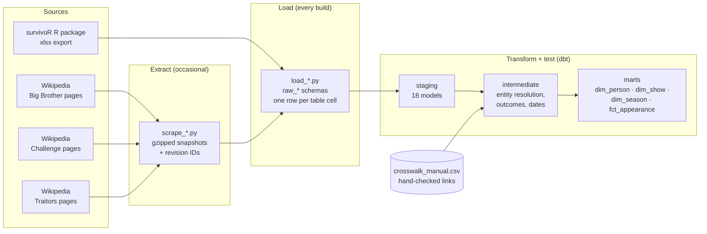
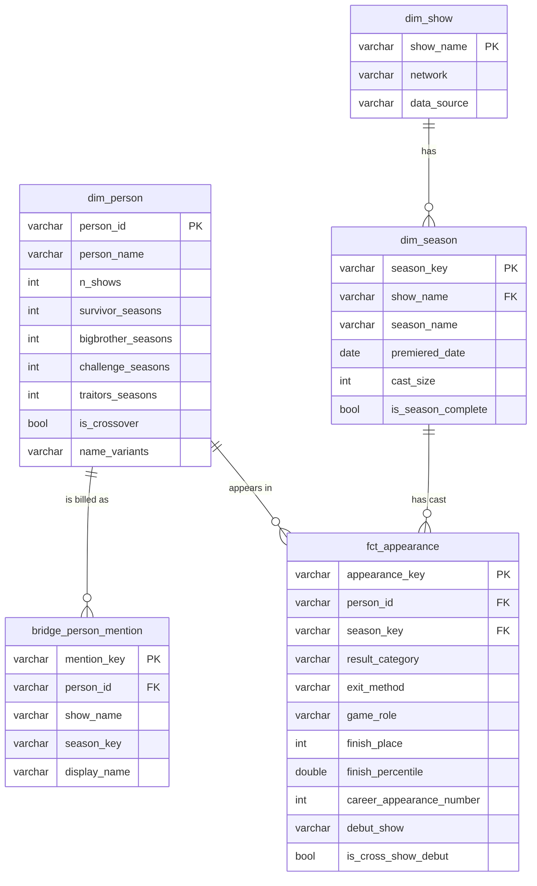

# Reality Competition Data Warehouse

[](https://github.com/tonishagordon/rc-warehouse/actions/workflows/dbt.yml)
· **[Browse the dbt docs and lineage →](https://tonishagordon.github.io/rc-warehouse/)**

One warehouse for **Survivor, Big Brother, The Challenge and The Traitors**, built from four sources that disagree with each other on almost everything. At its center is an **entity-resolution pipeline** that works out which records across the shows are the same person, so every contestant's full career can be followed from one show to the next.

| | |
|---|---|
| **Shows / seasons** | 4 shows · 136 seasons (1998–2026) |
| **People / appearances** | 1,637 people resolved from 2,850 season appearances |
| **Cross-show careers** | 77 people who competed on more than one show |
| **Data quality** | 109 automated dbt tests, 0 failures, 0 warnings · rebuilt and tested on every push |
| **Design decisions** | 14 documented in [`docs/decisions.md`](docs/decisions.md) |

**Stack:** Python (requests, BeautifulSoup, pandas) · DuckDB · dbt Core · GitHub Actions · GitHub Pages

---

## What this project demonstrates

| Client problem | Where it shows up here |
|---|---|
| Integrating sources that don't agree | A clean R dataset (survivoR), plus three sets of Wikipedia pages whose table layouts change from season to season |
| Master data / identity resolution | The same person billed as *"John Devenanzio"*, *"Johnny Devenanzio"* and *Johnny "Bananas" Devenanzio*, or as *Yamil "Yam Yam" Arocho* vs. *Yam Yam Arocho*, resolved to one ID |
| Dimensional modeling | A conformed `fct_appearance` with one outcome vocabulary across four shows with completely different rules |
| Data quality you can trust | Over-merge guards, typo-proof manual overrides, warn-level tests that surface new edge cases instead of hiding them |
| Extensibility | The Traitors was added as a 4th source **without redesigning anything** (D013) |
| Reproducibility | Raw snapshots are committed with revision IDs; CI rebuilds the whole warehouse from them on every push |

---

## Architecture



**Why load web tables as one row per cell?** Wikipedia's tables change shape constantly: merged cells, split double-eviction weeks, one-off twist tables. A cell-level raw layer never breaks on a new layout, and parsing logic can change without re-downloading anything. dbt staging models rebuild the tables they need (D005).

---

## Data model



**One vocabulary for four rulebooks (D012).** Survivor votes people out, Big Brother evicts, The Challenge eliminates, The Traitors banishes and murders. Every appearance gets the same `result_category` (winner / runner-up / finalist / eliminated / quit / removed / medical) and `exit_method` (jury_vote, eviction, banished, murdered…). A **finish place computed by one rule for every show** feeds a size-adjusted `finish_percentile` (1.0 = won, 0.0 = first out), so a 16-person Big Brother season can be compared fairly with a 40-person Challenge.

---

## Entity resolution

The hard part: nothing links the sources. A Challenge contestant's page says *"Big Brother 20"*, Big Brother's page says *"Faysal "Fessy" Shafaat"*, and survivoR knows him by an ID that no other source uses.

1. **Normalize names:** lowercase, strip accents and Unicode spaces, drop suffixes and punctuation, keep quoted nicknames separately (`normalize_name()` macro).
2. **Block on origin season:** "Big Brother 20" → compare only with the ~16 people in BB20, not all ~2,800 records. Applied to Challenge "Original season", Traitors "Notability", and Survivor seasons listed on Big Brother houseguest names (D008, D010).
3. **Score:** best of exact name, first + last, nickname + last, nickname + surname = full name, and Jaro-Winkler similarity.
4. **Decide:** auto-match only if the score is ≥ 0.93 **and** clearly ahead of the runner-up (margin ≥ 0.05). Near-misses go to a review queue.
5. **Cluster as a graph (D009):** every piece of evidence is an edge; people are the connected components (recursive CTE). One confirmed link resolves every record that shares that evidence.
6. **Human in the loop (D011):** a dbt seed records hand-checked `same` / `different` decisions. A test fails the build if any row doesn't match exactly one record on each side.

**Results**
- Challenge → Survivor/Big Brother origin links: **102 of 102 matched automatically**
- Traitors → Survivor/Big Brother origin links: **19 of 19** after two documented fixes (a nickname rule; non-breaking spaces, D014)
- Hand-confirmed links in the crosswalk: **7**, including Big Brother → Survivor crossovers (Caleb Reynolds, Hayden Moss) that no algorithm can find, because Survivor records don't list earlier shows. Reviewed lookalikes rejected: **6**
- **0 over-merges** (guard tests: one person can't hold two survivoR IDs or appear twice in a season)

---

## Early findings

*Previews from the marts. Samples are small, so treat these as leads, not conclusions.*

**The Strategist Penalty (The Traitors).** Survivor and Big Brother alums (n = 20) vs. everyone else (n = 68):

| | Survivor / BB alums | Everyone else |
|---|---|---|
| Cast as a Traitor | **40%** | 15% |
| Banished | **65%** | 43% |
| Murdered | 30% | 38% |
| Average finish percentile | 0.52 | 0.53 |
| Wins | 1 | 7 |

Alums are far more likely to be made Traitors and to be banished, and they're murdered less (kept around as shields?). They end up with similar placements but far fewer wins.

**Feeder shows (The Challenge).** In their *first* Challenge, Survivor debuts average a **0.59** finish percentile, and 9 of 18 made the final, vs. 0.47 for Big Brother debuts and 0.46 for everyone else.

---

## Run it yourself

```bash
git clone https://github.com/tonishagordon/rc-warehouse.git
cd rc-warehouse
python -m venv .venv && source .venv/bin/activate
pip install -r requirements.txt

bash scripts/build_warehouse.sh        # load raw snapshots + dbt build (models + tests)
cd dbt && dbt docs generate && dbt docs serve   # optional: browse docs locally
```

Everything rebuilds from the snapshots in `data/raw/`, with no network access. To refresh the source data (e.g. a new season), run the matching `ingest/scrape_*.py` script first.

---

## Repository layout

```
ingest/            scrape_*.py (extract) · load_*.py (load) · check_*.py (review scripts)
data/raw/          committed source snapshots (survivoR xlsx, gzipped Wikipedia pages + manifests)
dbt/
  models/staging/       one folder per show: rename, cast, filter to US
  models/intermediate/  entity resolution, outcomes, season dates
  models/marts/core/    dim_person, dim_show, dim_season, fct_appearance, bridge_person_mention
  seeds/                crosswalk_manual.csv (hand-checked same/different links)
  tests/                custom data tests (over-merge guards, crosswalk validation, date order…)
  macros/               normalize_name, nickname, origin_show
docs/decisions.md  14 design decisions, including the bugs that tests and reviews caught
scripts/           build_warehouse.sh
```

---

## Data sources and licenses

- **Survivor:** [survivoR](https://github.com/doehm/survivoR) by Daniel Oehm (MIT license). US seasons only. Demographic columns are deliberately not carried into the warehouse (D002).
- **Big Brother, The Challenge, The Traitors:** Wikipedia season pages, **CC BY-SA 4.0**. Fetched through the MediaWiki API with rate limiting and an identifying User-Agent; snapshots record each page's revision ID.
- Code in this repository: MIT (see `LICENSE`).

## Roadmap

- Streamlit app: Career Explorer, Feeder Show Report by origin show, Strategist Penalty
- Challenge elimination charts (`fct_elimination_event`)
- Voting facts across shows (Survivor tribal votes, Big Brother eviction votes, Traitors round tables)

---

*Built by Tonisha Gordon as a portfolio project.*
